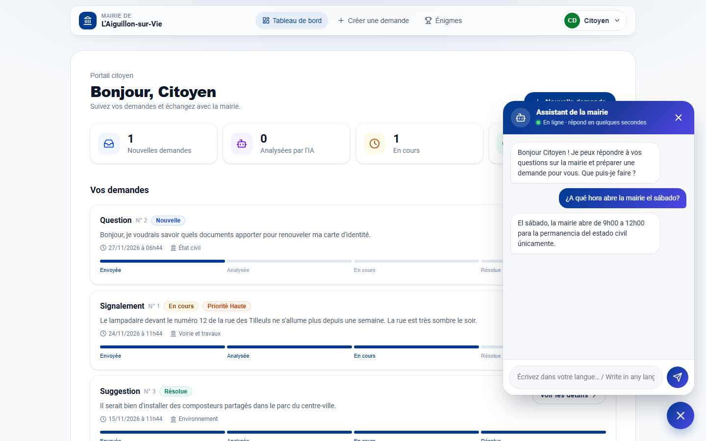
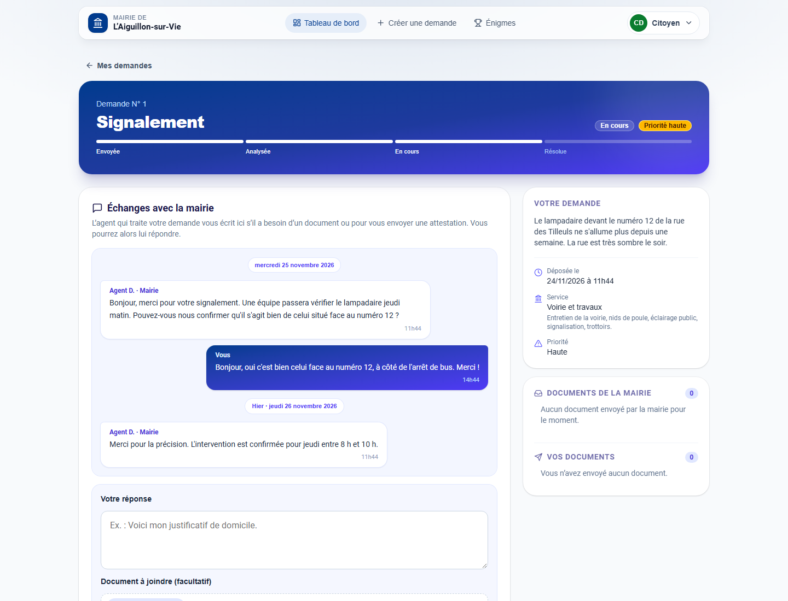
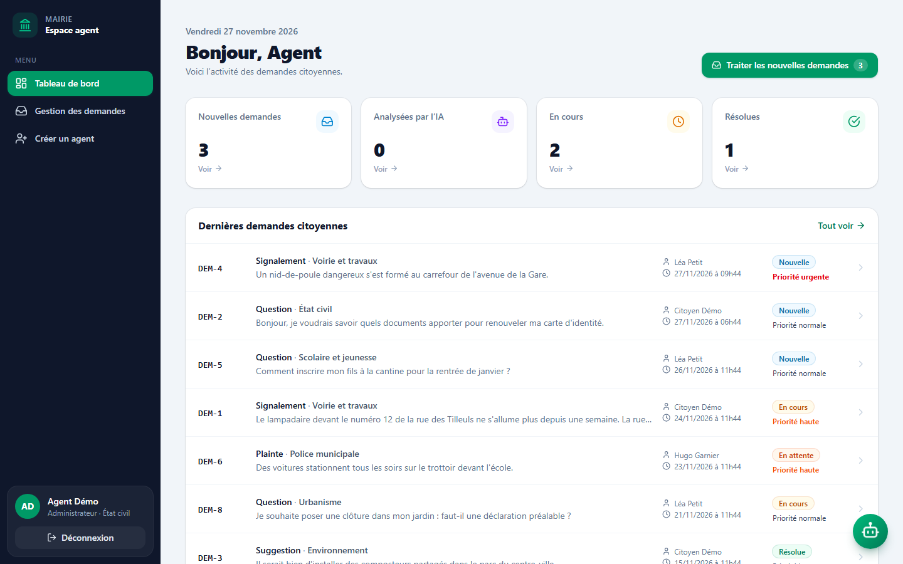
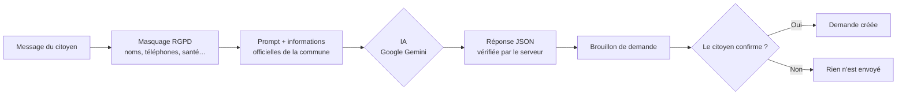

# Mairie_IA — Plateforme municipale avec assistants IA

> Portail citoyen et portail agent pour une mairie, avec deux assistants IA **encadrés** (Google Gemini), une messagerie mairie ↔ citoyen et une sécurité auditée selon l'OWASP.


**Statut : en développement actif.** Les portails citoyen et agent, les deux assistants IA, la messagerie et l'agenda fonctionnent ; d'autres modules sont en cours (voir [Feuille de route](#feuille-de-route)).

---

## Sommaire

- [Pourquoi ce projet](#pourquoi-ce-projet)
- [Les points forts](#les-points-forts)
- [Fonctionnalités](#fonctionnalités)
- [Captures d'écran](#captures-décran)
- [Architecture](#architecture)
- [Sécurité et RGPD](#sécurité-et-rgpd)
- [Installation](#installation)
- [Tester les assistants IA](#tester-les-assistants-ia)
- [Feuille de route](#feuille-de-route)
- [Méthode de travail](#méthode-de-travail)
- [Auteur](#auteur)

---

## Pourquoi ce projet

Pendant une année sabbatique, je me suis attaqué à un problème réel des mairies : **les agents croulent sous des demandes souvent mal orientées, et les citoyens peinent à trouver la bonne démarche.**

Mairie_IA répond aux deux côtés :
- le **citoyen** trouve une réponse à toute heure, dans sa langue, et suit ses demandes en ligne ;
- l'**agent** reçoit des demandes déjà qualifiées, échange avec le citoyen et garde une trace de tout.

L'IA y est un **assistant, jamais un décideur** : elle propose, l'humain valide.

---

## Les points forts

| | |
|---|---|
| 🤖 **IA encadrée** | Deux assistants (citoyen et agent). L'IA ne répond qu'à partir des informations officielles de la commune, refuse les manipulations (« ignore tes instructions… ») et ne fait **aucune action sans validation humaine**. |
| 🌍 **Multilingue** | L'assistant d'accueil répond dans la langue du citoyen (testé en 7 langues, dont l'arabe et le chinois) ; les agents reçoivent une traduction française. |
| 🔒 **Sécurité auditée** | Audit complet selon l'**OWASP Top 10** et corrections : contrôle d'accès, CSRF, XSS, IDOR, sessions, fichiers déposés. |
| 🛡️ **RGPD** | Données personnelles masquées avant tout envoi à l'IA, aucune conversation conservée, purge des anciennes données. |
| ⚡ **Temps réel** | Tableaux de bord, messagerie et historique se mettent à jour sans recharger la page. |
| 🔌 **IA facile à faire évoluer** | Tout l'accès à l'IA passe par un seul module : on change de modèle (ou de fournisseur) dans `.env`, sans toucher au reste du code. |

---

## Fonctionnalités

### Portail citoyen
- Création et suivi des demandes en ligne, tableau de bord **mis à jour automatiquement**
- **Assistant d'accueil IA 24h/24** : répond aux questions sur la commune, donne les numéros d'urgence en priorité, et propose de **préparer une demande que le citoyen relit et confirme lui-même** (ou lui indique comment la faire seul)
- **Échanges avec la mairie** : le citoyen lit les messages de l'agent, télécharge les documents envoyés (attestations…) et répond par un document et/ou un court message
- Badge « Nouveau message de la mairie » et notification par email (sans le contenu du message)
- Agenda municipal (FullCalendar) et page de détail des événements

### Portail agent
- Gestion des dossiers : statut, assignation, notes internes
- **Historique des actions** et **notes internes** avec filtres (type, 24 h, semaine, archive par mois)
- **Conversation avec le citoyen** : seul l'agent assigné à la demande peut écrire ; envoi de documents au citoyen
- **Documents du dossier** classés en trois cases : reçus du citoyen, envoyés au citoyen, internes à la mairie
- **Assistant IA agent** : analyse des demandes ambiguës, orientation vers le bon service (14 services), proposition de transfert **validée par l'agent**, rédaction de messages

---

## Captures d'écran

> Captures à venir.

<!--
Ajouter les captures dans docs/captures/ puis décommenter :




-->

---

## Architecture

```
Mairie_IA/
├── Frontend/              Portail citoyen et pages publiques (agenda, actualités…)
│   └── assets/            CSS, JavaScript (rafraîchissement automatique, messagerie…)
├── Agent-prenium/         Portail agent (tableau de bord, gestion d'une demande)
├── Backend/
│   ├── Config/            Configuration (.env), base de données, IA d'accueil
│   ├── Middleware/        Authentification, contrôle d'accès, jeton CSRF
│   ├── Fonctions/         Modules communs (historique, conversation, événements…)
│   ├── ajax/              Points d'entrée AJAX du portail agent
│   ├── citoyen/           Points d'entrée du portail citoyen
│   ├── chatbot/           Assistant d'accueil citoyen
│   └── Agent_API/         Assistant IA agent, fournisseurs d'IA, masquage RGPD
├── sql/
│   ├── mairie_ia_demo.sql Base de démonstration (données fictives)
│   └── migrations/        Migrations versionnées et relançables
└── tests/ia/              Scénarios de test des assistants IA
```

### Comment l'IA est encadrée



**Stack :** PHP 8.3 (PDO, sessions), MySQL 9, JavaScript (AJAX, Fetch), FullCalendar 6, Composer (`vlucas/phpdotenv`), API Google Gemini, WampServer / Apache.

---

## Sécurité et RGPD

| Risque (OWASP) | Protection mise en place |
|---|---|
| Contrôle d'accès défaillant | Middleware `exiger_agent()` / niveaux d'accès ; un citoyen ne voit que **ses** demandes (anti-IDOR) |
| CSRF | Jeton par session, vérifié sur chaque requête qui modifie des données |
| XSS | Échappement à l'affichage côté serveur, `textContent` côté navigateur, Content Security Policy |
| Fichiers déposés | Vérification du **type réel** du contenu, taille limitée, nom aléatoire sur le disque, exécution PHP désactivée dans le dossier |
| Exposition de fichiers | Listes blanches `.htaccess` : seuls les points d'entrée prévus sont accessibles |
| Abus | Limitation du nombre de messages et d'envois |
| Injection de prompt | Le texte du citoyen est traité comme une donnée, jamais comme une instruction |

**RGPD :** les noms, coordonnées et données de santé sont masqués avant tout envoi à l'IA ; aucune conversation n'est conservée en base ; les journaux ne contiennent aucune donnée personnelle ; des migrations purgent les données des anciennes versions.

---

## Installation

### Prérequis
- [WampServer](https://www.wampserver.com/) (Apache, PHP 8.1 ou plus, MySQL) ou équivalent
- [Composer](https://getcomposer.org/)
- Une clé API [Google Gemini](https://aistudio.google.com/apikey) (gratuite) pour activer les assistants IA — le reste du site fonctionne sans

### Étapes

1. **Cloner le projet** dans le dossier web de WampServer :
   ```bash
   cd C:/wamp64/www
   git clone https://github.com/MC666-coder/Mairie_IA.git
   cd Mairie_IA
   ```

2. **Installer les dépendances PHP :**
   ```bash
   composer install
   ```

3. **Créer le fichier de configuration** et le remplir (adresse du site, clé Gemini, nom de la commune) :
   ```bash
   cp .env.example .env
   ```
   Avec l'arborescence ci-dessus, `APP_URL=http://localhost/Mairie_IA`.

4. **Créer la base de données** dans phpMyAdmin (nom : `mairie_ia`), puis importer dans l'ordre :
   - `sql/mairie_ia_demo.sql` (base de démonstration, données fictives) ;
   - les fichiers de `sql/migrations/`, du plus petit numéro au plus grand (ils peuvent être relancés sans risque).

5. **Ouvrir le site :** <http://localhost/Mairie_IA/Frontend/index.php>

### Comptes de démonstration (fictifs)

| Rôle | Email | Mot de passe |
|---|---|---|
| Citoyen | `demo.citoyen@exemple.fr` | `DemoCitoyen2026!` |
| Agent | `demo.agent@exemple.fr` | `DemoAgent2026!` |

---

## Tester les assistants IA

Un jeu de 13 scénarios fictifs (demande ambiguë, tentative de manipulation, urgence sociale, données personnelles, sujet hors périmètre…) évalue l'assistant agent :

```bash
php tests/ia/comparer_ia.php --fournisseurs=gemini
```

Le rapport est écrit **hors du projet** (variable `RAPPORTS_IA_DIR`), avec une grille de notation par critère.

---

## Feuille de route

- [x] Portails citoyen et agent unifiés
- [x] Audit de sécurité OWASP et corrections
- [x] Conformité RGPD (masquage, purge, aucune conversation conservée)
- [x] Assistants IA encadrés et multilingues (Gemini)
- [x] Messagerie mairie ↔ citoyen avec documents
- [x] Agenda municipal et historique des actions
- [ ] Espace agent pour gérer les événements de l'agenda
- [ ] Quiz sur le patrimoine de la commune, avec classements
- [ ] Notifications
- [ ] Conteneurisation (Docker) et tests automatisés (PHPUnit)
- [ ] Mise en ligne

---

## Méthode de travail

Projet personnel : conception, base de données, back-end et front-end.

J'utilise un assistant de code IA (Claude Code) pour aller plus vite, comme le font aujourd'hui beaucoup d'équipes. Je définis chaque fonctionnalité et je fais les choix ; je relis, je teste (base de test séparée, tests sous Apache, scénarios d'attaque) et je valide chaque modification avant de la committer.

---

## Auteur

**Claude Marvine MBOUROU** — développeur web full stack en formation, à la recherche d'une alternance.

[LinkedIn](https://www.linkedin.com/in/claude-marvine-mbourou-ab05a12b7) · [GitHub](https://github.com/MC666-coder)
